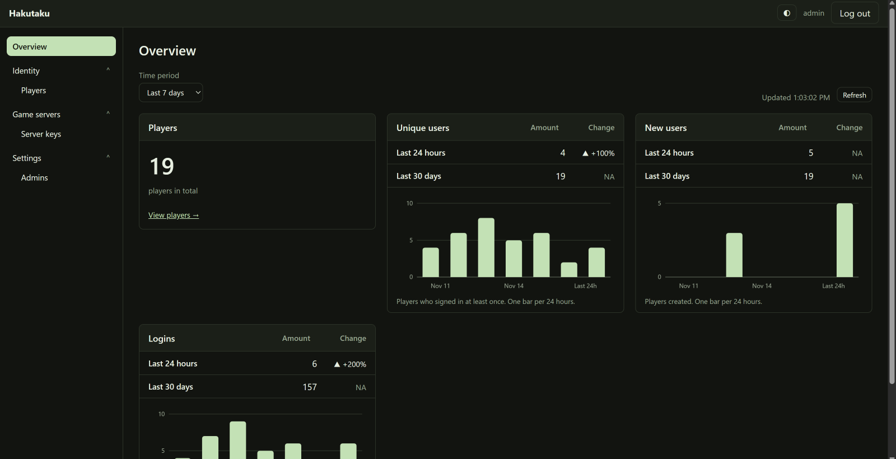

# Hakutaku

The backend for the **Fabled** plugin. It stores game data (players, characters, telemetry) like PlayFab does, and comes with an admin website for looking at it.

You don't need to know how any of it works to run it. Follow the steps below in order.

---

## Step 1: Install Docker Desktop (once)

Docker is what runs Hakutaku. It's the only thing you need to install.

1. Download **Docker Desktop** from <https://www.docker.com/products/docker-desktop/> and install it. Keep all the default options.
2. **Restart your computer** if the installer asks you to.
3. Open Docker Desktop and accept its terms. You can skip signing in.
4. Wait until the bottom-left corner says **Engine running**.

## Step 2: Download Hakutaku (once)

1. Go to <https://github.com/Bamboo01/Hakutaku>.
2. Click the green **Code** button, then **Download ZIP**.
3. Unzip it somewhere easy to find, for example your Documents folder. You get a folder called **Hakutaku-master**.

> If you already use Git, `git clone https://github.com/Bamboo01/Hakutaku.git` does the same thing, and the folder is just called `Hakutaku`.

## Step 3: Start it

**Windows:** open the folder that has **`start.bat`** in it and double-click `start.bat`. (Windows sometimes unzips into a `Hakutaku-master` folder *inside* another `Hakutaku-master` folder. If you don't see `start.bat`, open the inner one.)

**Mac or Linux:** open the **Terminal** app. Type `bash` followed by a space, drag **`start.sh`** from the Hakutaku folder into the Terminal window, then press Enter.

A window full of text appears. **The first time takes 5–10 minutes**, because it downloads and builds everything. After that, it starts in a few seconds.

When it's done, your web browser opens the admin site by itself.

## Step 4: Log in

The admin site is at **<http://localhost:8090>**. Note the **`:8090`** at the end. Plain `http://localhost` will not work.

| | |
|---|---|
| Username | `admin` |
| Password | `hakutaku` |

The project wiki (the full documentation) is at <http://localhost:5020>.

## Using the admin site

The admin site works like PlayFab's Game Manager: a menu on the left, and pages made of panels.



### The menu

| Menu item | What it's for | Who sees it |
|---|---|---|
| **Overview** | How the game is doing: players, sign-ins, new players | Every admin |
| **Identity → Players** | Look up a player and see or change their data | Every admin |
| **Game servers → Server keys** | Make the keys a game server uses to talk to Hakutaku | The owner (`admin`) only |
| **Settings → Admins** | Add or remove other admin accounts | The owner (`admin`) only |

Click a heading (Identity, Game servers, Settings) to fold it away. On a narrow window the menu hides behind the **☰** button at the top left. The **◐** button switches between light and dark mode.

### Overview

The page you land on after logging in (shown above).

- **Players** is how many players exist in total.
- **Unique users** is how many different players signed in. **New users** is how many players were created. **Logins** is how many times players signed in (making a new player counts as one).
- Each panel shows the **Amount** for the last 24 hours and the last 30 days, and the **Change** against the period before (for example, the 24 hours before that). **NA** means there was nothing to compare with.
- The bars below show one bar per day. Hover over a bar to see its exact number. Choose how many days to show with **Time period** at the top.
- A "day" here is a rolling 24 hours, so "Last 24h" means exactly the last 24 hours, not "today".
- The numbers don't update by themselves. Click **Refresh** for the latest.

### Players

**Identity → Players** lists every player, newest first.

- Type in the **search box** to find a player by display name or by player ID.
- Click **Display name**, **Created** or **Last login** at the top of the list to sort by it. Click again to reverse.
- Click a player to open their page.

### A player's page

A player's page has two tabs.

**Overview** shows who they are: their display name, player ID (with a **Copy** button), when they were created and last signed in, and how they sign in (**Linked accounts**). An email that hasn't been confirmed yet shows as **Unverified**. The email address itself is never shown.

**Player Data** shows the values the game keeps for this player, such as their XP, in three groups. Pick a group with the buttons at the top:

| Group | Who can change it |
|---|---|
| **Client writable** | The player's game itself |
| **Read only** | Only the game server. XP is kept here |
| **Internal** | Only the game server, and the player never sees it |

To change a player's data:

1. **Edit a value:** click it and type. Short values are edited right in the list. Long ones, and JSON, open a bigger editor (also opened with the **⤢** button), which has a **Format JSON** button to make JSON readable.
2. **Add a value:** click **+ Add key**, give it a name (letters, numbers, `_`, `.` and `-` only) and a value, and click **Apply**.
3. **Delete values:** tick the boxes next to them and click **Delete**.
4. Nothing is changed yet. Changed rows are marked **edited**, **new** or **deleted**, and every one has an **Undo** button. **Discard** throws away all your changes in that group.
5. Click **Save**. You'll be asked to confirm. **This changes the real player straight away**, and the game server will see the new values.

A few limits apply, and the page tells you before you save if you break one: at most 10 changes per save, values up to 16 KB, and up to 100 values per group. If you leave the page with unsaved changes, it asks first.

### Server keys (owner only)

A game server needs a **server key** to read and save player data. Type a name (for example `homelab`), optionally pick when it should stop working, and click **Generate key**. **The key is shown only once.** Copy it straight away and give it to whoever runs the game server. If a key leaks, click **Revoke** and it stops working at once. That can't be undone; just make a new one.

### Admins (owner only)

Add admin accounts for teammates (they get everything except Server keys and Admins), or **Deactivate** one to lock it out at once.

## Stopping it

**Windows:** double-click **`stop.bat`**.

**Mac or Linux:** same as starting, but drag in **`stop.sh`** instead.

Your data is saved and will be there next time you start it. After stopping, you can close Docker Desktop too.

## Getting the latest version

Stop Hakutaku, download the ZIP again and replace the old folder with the new one (or run `git pull` if you used Git), then start it again. Your data is kept.

---

## Something went wrong?

### "Docker is not installed" or "Docker is not running"

Go back to [Step 1](#step-1-install-docker-desktop-once). On Windows the script tries to open Docker Desktop for you, but the very first time you have to open it yourself and accept its terms.

### Docker Desktop won't start on Windows (it mentions virtualization or WSL)

Virtualization has to be switched on in your computer's BIOS settings. See the [setup guide](docs/setup.md#step-2--docker) for how, or ask someone on the team.

### "port is already allocated"

Another program on your computer is already using one of the ports Hakutaku needs (80, 5020, 5432 or 8090). The usual culprits are a PostgreSQL install (port 5432) or IIS/Skype (port 80). Close that program, then start Hakutaku again.

### The page can't be reached, or `http://localhost` shows a 404 error

Check the address ends in **`:8090`**. If it does, wait half a minute and refresh, because the server may still be starting.

### The password `hakutaku` doesn't work

You probably ran an older version of Hakutaku before, and its database still has the old password. You can wipe the local database and start fresh. **This deletes all your local Hakutaku data. Make sure you back any important data up.**

Open a terminal in the folder that has `start.bat` in it:

- **Windows:** click the address bar at the top of File Explorer, type `cmd` and press Enter.
- **Mac or Linux:** open Terminal, type `cd` followed by a space, drag the folder into the window and press Enter.

Then run:

```
docker compose -f compose.dev.yaml down -v
```

and start Hakutaku again.

### Anything else

The start window prints what went wrong. Send a screenshot of it to the team.

---

## For developers

The steps above run everything in Docker with no hot reload. To work on the code you'll also want the **.NET 10 SDK** and **Node 22+**, and the dev loop in [docs/setup.md](docs/setup.md#mode-b--dev-loop-the-normal-one).

### Working on the admin site

The admin site is a Vue 3 + TypeScript app in [`web/`](web/). To change it with live reload, run the API and the UI in two terminals from the repo root (Postgres from `start.bat`/Docker can stay running):

```bash
cd server && dotnet watch          # the API on :5008
cd web && npm install && npm run dev   # the UI on http://localhost:5173, sending /api to :5008
```

Log in at <http://localhost:5173> with the same `admin` / `hakutaku`.

- **Run both on Windows itself, not in WSL.** The project needs the .NET 10 SDK, and the UI in WSL can't reach an API running on Windows.
- **In PowerShell, use `npm.cmd`** (`npm.cmd run dev`) if you get "running scripts is disabled on this system". It's the same npm without the blocked script wrapper.
- `cd web && npm run build` type-checks and builds it, as the Docker image does.
- Each page is one file in `web/src/pages/`, and adding a route to `web/src/router.ts` (with `nav` and `group`) puts it in the menu. See [Web UI](docs/components/web.md) for how it's put together.
- The production admin site isn't public. Reach it through the SSH tunnel in [Deploy](docs/operations/deploy.md).

### Docker

The scripts are thin wrappers around `docker compose -f compose.dev.yaml up -d --build` and `... down`. `compose.dev.yaml` is **local-only** (hardcoded credentials, no TLS), so never deploy it. Production uses `compose.yaml`; see [Deploy](docs/operations/deploy.md).

### The wiki

Assume the wiki in [`docs/`](docs/) is **slightly out of date**. The project is still very much a **work in progress!!** But below are the important sections you may want to check out if you're planning to develop:

| | |
|---|---|
| [Setup](docs/setup.md) | Every install step in detail, plus troubleshooting |
| [Project structure](docs/architecture/structure.md) | Layout, tech stack, why |
| [API reference](docs/reference/api.md) | Every endpoint and error shape |
| [Auth and sessions](docs/components/auth.md) | Hashing, cookies, expiry, roles |
| [Web UI](docs/components/web.md) | How the admin site is built, page by page |
| [Deploy and CI/CD](docs/operations/deploy.md) | The VM, Jenkins, the SSH tunnel |
| [Contributing](docs/reference/contributing.md) | Branches, migrations, house style |

[TODO.md](TODO.md) is the roadmap.
